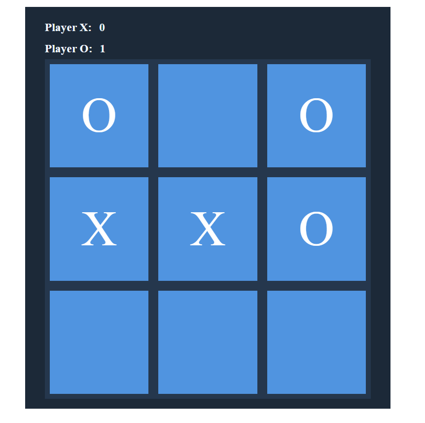

# ❌⭕ Tic-Tac-Toe
A two-player Tic Tac Toe game for the browser, built with vanilla HTML, CSS, and JavaScript. Players X and O take turns on a 3x3 board while the scoreboard keeps track of who is winning.

## Live Demo
🔗 [Play Game](https://clauya.github.io/Tic-tac-toe/)

## Features
- 3x3 game board for two players (X and O)
- Scoreboard next to each player's name
- **Play** button to start a game and **Reset** button to start over
- Board scales with the screen size using viewport units

## How to Play
1. Press **PLAY** to start.
2. Players take turns clicking an empty square to place their X or O.
3. The first player to get three in a row (horizontal, vertical, or diagonal) wins the round, and their score goes up.
4. Press **RESET** to clear the board and play again.

## Technologies Used
- **HTML5:** semantic structure (`header`, `section`, `button`)
- **CSS3:** Flexbox for layout and centering, `vw` units so the board scales with the screen
- **normalize.css:** consistent styles across browsers
- **JavaScript (vanilla):** game state, turns, win checks, and score updates (`js/objects.js`)

## Getting Started
No build step or dependencies needed.
You can also use the VS Code **Live Server** extension to run it locally.

## What I Learned
- Organizing game logic with JavaScript objects
- Tracking game state, turns, and scores
- Detecting winning combinations on a grid
- Using Flexbox to build and center a game board
- Making a layout flexible with relative units

## Future Improvements
- Highlight the winning row
- Add a draw message and a turn indicator
- Play against the computer